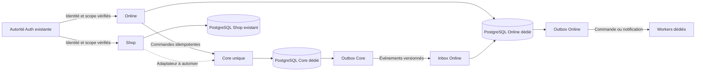

# ADR-J43A-001 — Autorité Core et séparation physique

Statut : **PROPOSÉE — décision requise, extraction physique non implémentée**.
Date : 2026-10-29. Référence : `e34ea2f0d9c5f3270129e4b163e373f701f84520`.

## Problème démontré

Le checkout, le changement de statut/paiement, la revalidation des réservations et l'outbox utilisent une même `Session` et le même commit. Les verrous produits, l'expiration relue après attente et les flush J4.2.1 protègent cette atomicité locale. Une seconde `DATABASE_URL` détruirait ces garanties : rollback Online ne rollbackerait pas Core.

Shop écrit directement le stock, alors qu'Online conserve les consommations comme réservations consommées. Une duplication de `products` dans Online donnerait deux autorités et ne réglerait pas la survente. Le complément de cartographie externe contient aussi `shop_inventories` : l'autorité par boutique et sa correspondance avec la référence Online doivent être décidées.

Le runtime existant exécute du DDL au démarrage, utilise des lectures publiques avant résolution du tenant et des refresh après commit. Il n'est pas compatible tel quel avec le rôle minimal et la RLS généralisée du laboratoire. Le worker historique possède un chemin de bypass par GUC. J4.3A ne l'active pas et ne le réutilise pas dans les nouvelles policies.

## Architecture cible soumise à validation

Core possède l'identité produit, la disponibilité, les réservations, mouvements et transactions métier. Online possède storefronts, paniers, commandes et projections nécessaires à l'affichage ; ces projections ne peuvent jamais autoriser une réservation. Shop conserve son stockage et son service jusqu'à une intervention distinctement autorisée. Auth conserve credentials, sessions et révocation ; aucune copie de son moteur dans Online/Core.

Cible d'isolation : instances PostgreSQL distinctes pour Core et Online staging, distinctes de Shop staging et de toute production, identifiants et rôles propres à chaque instance, pas d'utilisateur partagé, pas de FDW/dblink/liaison inter-base, pas de superuser d'exploitation dans les applications. Un simple changement de schéma ne constitue pas la séparation physique demandée.

Chaque autorité a une transaction SQL locale pour l'effet, le reçu de commande et l'outbox. Livraison au moins une fois, déduplication dans l'inbox du destinataire avec son effet local. Aucune promesse « exactement une fois » du réseau. Une indisponibilité Core ferme les mutations de stock ; un catalogue éventuellement ancien peut rester lisible avec un état de disponibilité non garanti.

## Décisions à valider avant toute implémentation dépendante

| ID | Décision | Proposition et critère |
| --- | --- | --- |
| D1 | Orchestration inter-base | Saga persistée côté Online, reprise après crash, états attente/échec visibles ; pas de transaction SQL distribuée. Choisir transport, authentification service, stockage/ordonnancement des reprises et propriétaire opérationnel. |
| D2 | Consommation/vente/annulation | Core seul comptabilise le stock une fois. Proposition : `RecordSale` peut consommer et enregistrer atomiquement dans Core ; s'il reçoit un ensemble déjà consommé, il ne décrémente jamais à nouveau. Annuler une vente terminée est une compensation journalisée selon règles de retour, pas une remise à zéro du stock. Valider les états, la comptabilité et le lien entre les deux commandes. |
| D3 | Stock partagé Shop | Faire passer ventes, annulations, achats, ajustements, imports et stock par boutique de Shop par Core avant de déclarer l'autorité unique. Aucune activation Online séparée avec writers Shop directs concurrents. Autorisation Shop distincte indispensable. |
| D4 | Identité/IDs et données | IDs marchands/produits/boutiques stables ou mapping contrôlé, NULL historiques mis en quarantaine, scope boutique explicite ; pas de réattribution automatique. `merchants` est identité métier, pas table de credentials. |
| D5 | Sécurité et démarrage | Migrations hors startup, résolution tenant pour storefront public sans lecture privée globale, contexte transaction-local à chaque transaction et après commit, worker tenant-scoped. Le runtime ne dispose pas du rôle migrateur. |
| D6 | Reprise opérationnelle | RPO/RTO, rétention des reçus, sauvegarde/PITR, image applicative compatible avec la base dédiée, arrêt des writers et stratégie après point de bascule validés par exploitation. |

Les paramètres de timeout/retry et les enveloppes sont préparés dans [CORE_CONTRACT.md](CORE_CONTRACT.md). Leur implémentation de transport et les nouvelles transitions métier restent arrêtées tant que D1–D6 ne sont pas validées.

## Frontière de la livraison locale

Livré : contrats Python sans transport, inventaire, quatre migrations **de laboratoire vide**, rôles minimaux, RLS, intégrité tenant, reçus/outbox/inbox exercés localement, régressions SQL sur PostgreSQL 18.6, sauvegarde/restauration entre deux instances jetables.

Non implémenté volontairement : extraction de Core, routage vers deux bases, nouvelles transactions distribuées, migration de données existantes, adaptateur Shop, changements Auth, transport d'événements interservices, migration Railway. Ce sont les parties qui exigent la décision d'architecture demandée par le sprint.

Le laboratoire conserve Core et Online co-localisés pour tester les invariants existants. Sa seconde instance est une **destination de restauration**, pas un faux Core distribué. Les tests de reçus sont des preuves de primitives locales, pas une preuve d'une saga ou d'un checkout inter-bases.

## Alternatives écartées

- Copier le stock dans Online et synchroniser ensuite : ne conserve pas une autorité unique, concurrence globale non maîtrisée.
- Rôles distincts sur la même base comme résultat final : progrès de permissions, mais isolation physique non réalisée.
- Deux commits SQL dans le parcours existant : résultat partiel après timeout/crash, compensation non définie.
- RLS désactivée ou runtime propriétaire/SUPERUSER pour compatibilité : annule les garanties recherchées.
- Restaurer Shop pour annuler une bascule Online : interdit, et risque d'effacer des opérations Shop indépendantes.

## Acceptation de l'ADR et passage J4.3B

D1–D6 doivent être approuvées et reliées à des livrables testables. Avant une bascule réelle : test de bout en bout sur deux autorités physiques avec coupures réseau/crash, rejeu ambigu, doublons/désordre d'événements, expiration/concurrence, annulations et non-survente globale ; preuve de sauvegarde/restauration de la source autorisée ; version applicative antérieure compatible avec la base dédiée ; accès administrateur réellement authentifié. Les tests locaux présents ne ferment pas ces critères.
