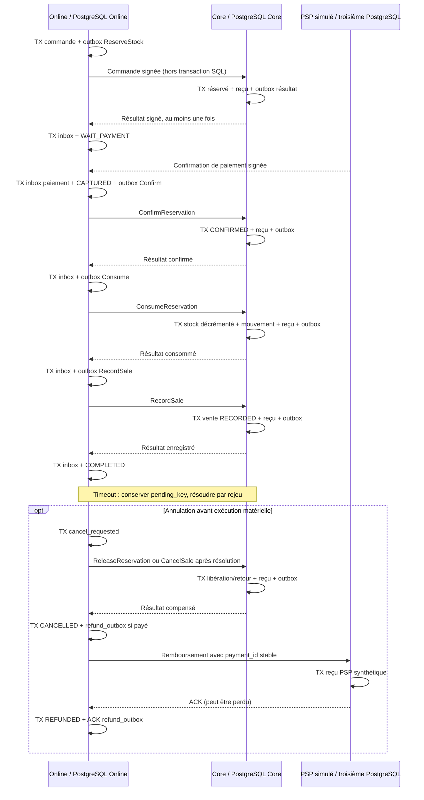
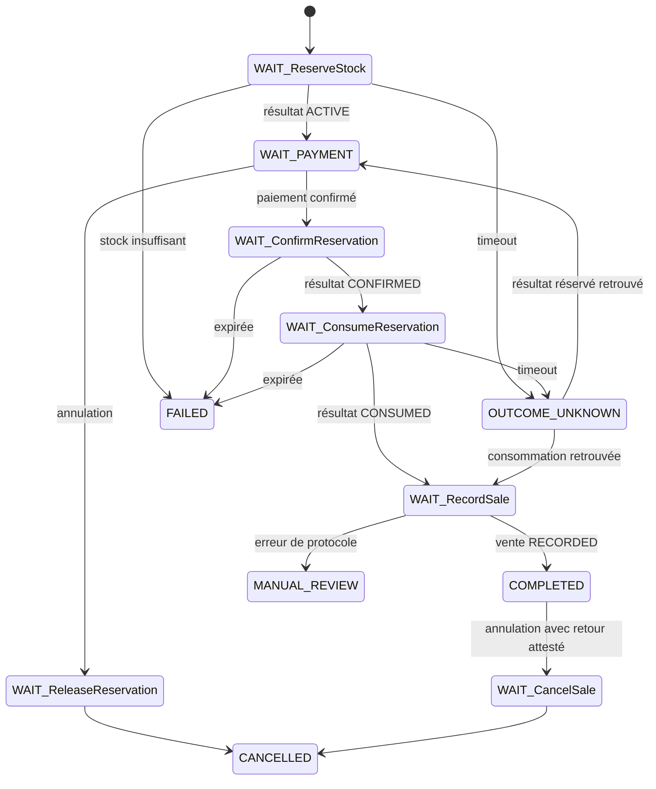
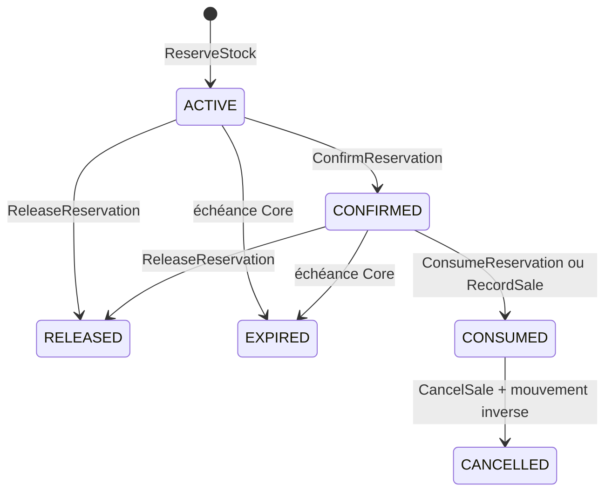
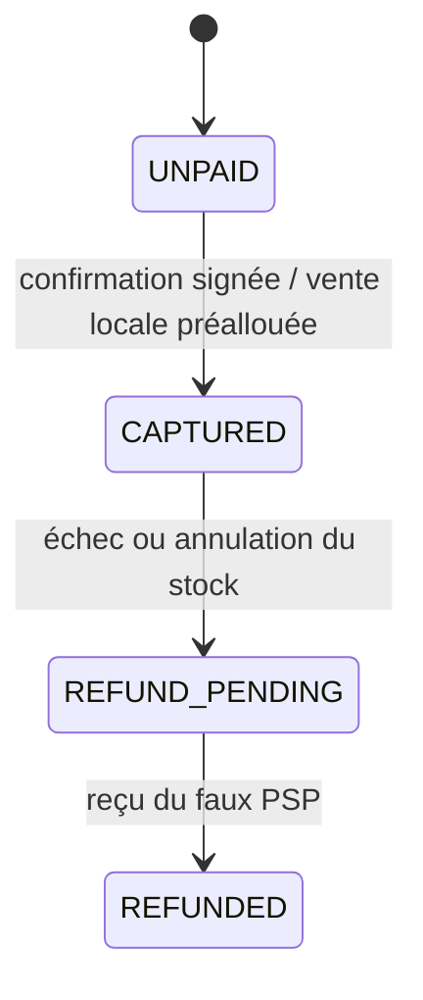

# Orchestration et machines à états

Implémentation isolée : `scripts/j43c/orchestrator.py`, `core.py`, `core.sql`, `client.sql`. Le simulateur Shop réutilise la saga mais écrit dans sa propre instance, sans import ni modification du code Shop existant.

La confirmation PSP est injectée par le test sous une identité synthétique. Le faux fournisseur de remboursement persiste ses reçus dans la troisième instance ; il ne s'agit pas d'un vrai PSP.

## Commande

`cancel_requested` est orthogonal à l'état. Il reste persisté pendant un paiement ou une commande Core en vol. Tout état d'attente de commande peut devenir OUTCOME_UNKNOWN. Les diagrammes illustrent les transitions principales ; le contrat exécutable est `_drive` et les tests de courses. Un ACK transport ne suffit pas à faire avancer la saga : elle attend le résultat Core, conservé dans son outbox.

## Réservation et paiement

La vente suit `PENDING → RECORDED → CANCELLED` ou `PENDING → CANCELLED`. La consommation et l'enregistrement peuvent être atomiques dans Core. Aucun état terminal de réservation n'est ressuscité.

Une confirmation tardive sur une commande annulée déclenche un remboursement. Une répétition de confirmation ne ramène jamais REFUNDED à CAPTURED. Une panne de remboursement laisse REFUND_PENDING et sa sortie durable.

## Frontières de crash vérifiées

| Frontière | Reprise |
| --- | --- |
| Avant commit Online | Aucune commande ni outbox partielle ; même requête de création rejouable. |
| Avant émission de la commande | Outbox Online pending retrouvée après reconstruction de l'orchestrateur. |
| Avant outbox/commit Core | Effets annulés ; tests avec exception et processus arrêté par `os._exit`. |
| Après commit Core, avant réponse/ACK | Réservation persistée ; même reçu, même événement au rejeu ; aucun double effet. |
| Avant publication Core | Outbox Core non acquittée ; publication suivante. |
| Après réception Online, avant ACK publication | Inbox empêche le second effet ; ACK peut être répété. |
| Avant commit inbox | Inbox et transition annulées ensemble ; réception suivante applique l'effet. |
| Après remboursement simulé, avant ACK Online | Reçu PSP durable ; le même payment_id ne rembourse pas deux fois. |

Les exceptions de test interrompent la fonction au point nommé. Les cas `test_real_process_death_and_recovery` arrêtent réellement un processus Python avec une connexion active avant commit, ou après commit. Un test Uvicorn/requests sur loopback provoque aussi un vrai timeout de lecture HTTP après le commit Core puis retrouve le reçu au retry. La recette ne simule pas une panne disque/hôte ni une partition TCP avec proxy ; ces limites restent explicites.
