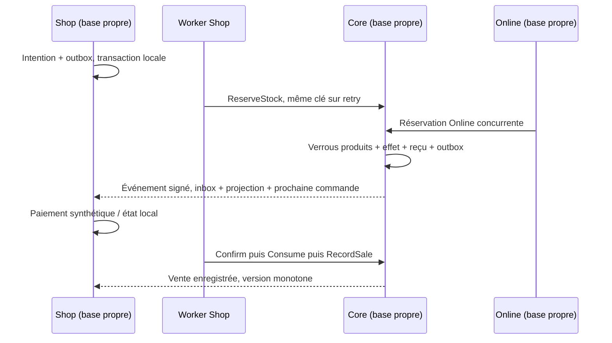

# J4.3D — Autorité et adaptateur préparatoire

Base : `aeacb36`. Les fondations des PR [#8](https://github.com/sowhatt/whatsapp-fastapi-rag/pull/8) (`d1e5dfa`) et [#9](https://github.com/sowhatt/whatsapp-fastapi-rag/pull/9) (`aeacb36`) ont été vérifiées en lecture seule : ouvertes, brouillons, non fusionnées au moment de l'audit. Le prototype J4.3C est réutilisé sans modification.

## Décision d'autorité

L'unité d'autorité est la clé complète **(tenant_id, shop_id, product_id)**. Une disponibilité de catalogue, un stock dans IndexedDB, un journal de mouvements ou une projection ne peut accorder du stock.

| État | Autorité de quantité | Opérations permises |
| --- | --- | --- |
| LEGACY, état actuel de tous les pilotes | Shop existant : `ShopInventory` si boutique résolue, sinon stock historique `Product` | Comportement existant inchangé ; aucune garantie distribuée ajoutée. |
| FROZEN, état de transition proposé | Aucun nouveau writer | Drain/reconciliation autorisés séparément ; refus de nouveaux engagements. |
| CORE, uniquement fixtures dans cette livraison | Base Core, transaction locale avec verrou de chaque produit | Les canaux créent des commandes ; seul Core modifie quantités, réservations, journal et reçus. |
| Inconnu / boutique non résolue | Aucune autorité cible attribuable | Flag désactivé : chemin existant ; préparation Core activée en fixture : refus `AUTHORITY_UNRESOLVED`. |

Un panier mélangeant des clés LEGACY/CORE est refusé avant toute écriture. Le découpage en sous-commandes créerait un panier partiellement engagé sans protocole défini. Un produit CORE avec flag désactivé est suspendu (`CORE_AUTHORITY_PAUSED`), jamais renvoyé au writer historique. Un flag n'est donc **pas** un bouton de rollback de stock.

Dans le laboratoire, la table d'autorité est un mapping immuable injecté pour la durée d'un scénario. Il n'existe ni registre persistant de bascule, ni epoch de fencing dans le contrat v2. C'est une limite bloquante pour la production, explicitement distincte des tests de non-survente sous autorité Core constante.

## Adaptateur livré, sans raccordement applicatif

`scripts/j43d/adapter.py` ne modifie aucune route, configuration, migration, startup ou variable d'environnement. `BridgeSettings.shop_core_adapter_enabled` vaut **False** par défaut et ne lit même pas l'environnement. Les seules valeurs True sont des injections de fixtures synthétiques. Aucun flag d'application n'a été créé ou activé.

`prepare` valide le périmètre sous l'identité Shop/terminal résolue, les quantités et l'autorité. `stage_sale` prépare la vente durable dans la base Shop du laboratoire ; son retour est un identifiant d'intention, **pas une autorisation de remettre la marchandise**. En mode historique, il retourne `None` sans construire de client, ouvrir de base ou appeler le réseau. Aucun appelant réel n'a été ajouté.

Une clé POS stable ou `offline_sale_id` doit précéder le premier essai. L'UUID de commande découle de `(tenant, boutique, source=shop, operation_id)` ; il ne dépend ni du contenu, ni du terminal, ni d'un futur epoch. Changer le contenu sous la même clé produit donc un conflit de reçu, pas une seconde vente. Les lignes sont canonisées ; montant, devise, terminal et mode offline participent à l'empreinte persistante. Les clés des transitions suivantes sont créées une fois puis conservées dans l'outbox.

L'outbox et les reçus gèrent la livraison au moins une fois. En cas de timeout, l'état est ambigu ; l'intention persiste et le worker rejoue la même commande. Aucune restitution spéculative. Les événements tardifs ne régressent pas la version de projection. Les lecteurs SQL Online/Shop ne disposent pas de table `inventory` Core ; les bases n'ont pas de FK entre elles.

`cancel_before_fulfilment` exige une déclaration explicite de marchandises conservées. Si des biens ont été remis ou retournés, l'adaptateur refuse et requiert un futur parcours de retour physique. Il vérifie l'empreinte de l'intention existante avant compensation. Cette déclaration est une précondition de laboratoire, pas une preuve de garde physique ni une permission Auth V2.

## Invariants et périmètre de la preuve

Dans le Core : `0 <= reserved <= physical`, `consumed >= 0`. Les réservations multi-produits prennent les verrous dans l'ordre des produits ; l'échec d'une ligne empêche l'ensemble. Les reçus sont atomiques avec effet métier et outbox.

Pour les fixtures sans achats ni corrections : `physical + consumed = opening`, `physical = opening + somme(movements.delta)`, `reserved = somme(lignes ACTIVE ou CONFIRMED)`. Une annulation remet une unité au plus une fois. Le stock dit physical est le **solde comptable Core** ; pendant une coupure, des biens vendus localement restent couverts par reserved jusqu'à synchronisation. Ce compteur n'est pas une mesure physique du rayon.

Les tests prouvent ces propriétés pour le prototype et les scénarios exécutés, sous service Core honnête et autorités constantes. Ils ne constituent pas une preuve de non-survente de l'application Shop actuelle, d'un navigateur cloné ou de tous les ordonnancements possibles.

## Plan de bascule — arrêté avant toute écriture Shop

1. Après autorisation distincte, inventorier versions déployées et writers opérateurs. Résoudre merchant→tenant, boutique et produit sans identifiant implicite. Conserver les droits existants Auth V2, l'origine offline, le rôle utilisateur et les permissions de vente/annulation/stock.
2. Ajouter les contrats manquants `OpenInventory`, `ReceiveStock`, `ReverseReceipt`, `AdjustInventory`, `AcceptReturn`. Reçus immuables, référence métier et motif, version attendue pour le comptage, refus de sortie sous les engagements existants. Les retours non revendables vont en quarantaine, pas dans le disponible.
3. Préparer un registre durable par clé, epoch monotone et preuve de retrait de tous les anciens writers. L'epoch doit être contrôlé dans la même transaction que chaque effet Core. La simple reconstruction du mapping Python n'est pas un fencing.
4. Préparer les writers de la matrice ensemble, dont listener, initialisation, import `affect_stock=false`, crédit et annulations. Persister l'intention et l'outbox dans **la transaction métier Shop** ; le laboratoire n'est pas cette transaction. Journal Shop et projection ne décrémentent plus le stock local pour une clé CORE.
5. Passer les seules clés autorisées en FROZEN ; bloquer ventes, achats, corrections, imports et allocations. Drainer les commandes, rapprochements et terminaux offline ou maintenir leur stock sous séquestre. Capturer un solde validé et un watermark, jamais un simple copier/coller de `Product.stock`.
6. Importer une ouverture unique après réconciliation ; rapprocher réservations/ventes à la frontière, retirer les privilèges des writers historiques et tester qu'un ancien binaire ne peut écrire. Les privilèges partagés de colonnes ne suffisent pas pour une bascule par produit : politique/procédure conditionnelle et rôles séparés nécessaires.
7. Basculer le registre vers CORE avec epoch, puis seulement activer un périmètre explicitement autorisé. Canary, métriques de backlog/ambiguïtés/divergence et critères d'arrêt. En panne Core, refuser les ventes connectées ou utiliser un quota déjà acquis.
8. Rollback après consommation Core : FROZEN, drainage, rapprochement inverse contrôlé et nouveau watermark/epoch. Ne jamais réactiver le writer legacy par simple désactivation du flag.

**Aucune étape de ce plan n'a été appliquée aux writers ou données réels.** Les étapes 1–8 demandent une mission d'intégration autorisant leurs modifications. La présente mission s'arrête à cette frontière pour la partie Shop.
